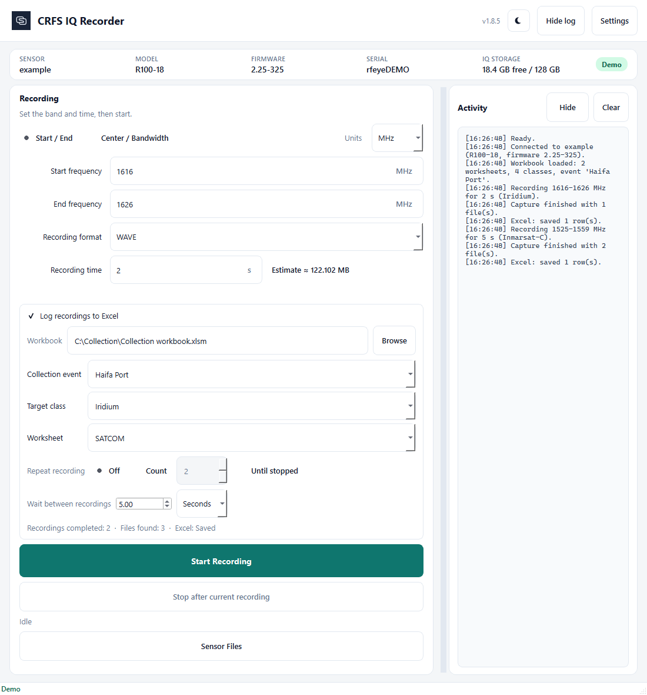

# CRFS IQ Recorder

Starts an IQ recording on a CRFS RFeye sensor, lists files over SFTP, and downloads WAVE files to this PC.

How the Recorder, Node, local files, Excel, and Converter fit together is in [Architecture](docs/ARCHITECTURE.md).



## Share the EXE

On a PC with Python, double-click `build_exe.bat`. Copy `dist\CRFS_IQ_Recorder.exe` to a USB stick or shared folder. The other PC does not need Python. Set `CRFS_BUILD_INSTALLER=1` to also get `dist\CRFS_IQ_Recorder_Setup.exe`, an installer for company-managed PCs.

The EXE is not stored in Git. Each version is tagged and the EXE is attached to the matching GitHub Release (keep older releases for rollback).

### Windows warnings, signing, and the icon

Full analysis, signing enrollment steps and costs, IT guidance, and the diagnostics script are in [Distribution](docs/DISTRIBUTION.md).

- **"Windows protected your PC" / "Unknown publisher"** on first run is Microsoft Defender SmartScreen: the EXE is not signed with a trusted code-signing certificate, and every new build is a new file hash with no download history. Defender itself reports no threat for the build (checked with `MpCmdRun -Scan` before each release).
- **"Cannot run at all"** on a Windows 11 PC with **Smart App Control** on, or on a company PC with App Control (WDAC) / AppLocker: unsigned code is refused, including the DLL/PYD files the one-file EXE unpacks into `%TEMP%`. Turning those protections off is not the fix.
- **What fixes the publisher part:** sign every release, and every bundled binary, with a trusted identity. The build does this automatically when one of `CRFS_SIGN_ARTIFACT_METADATA` (Azure Artifact Signing, formerly Trusted Signing, the recommended option), `CRFS_SIGN_THUMBPRINT` (certificate in the Windows store or on a token) or `CRFS_SIGN_PFX` + `CRFS_SIGN_PFX_PASSWORD` is set; see `sign_exe.ps1`. Signing names the publisher, satisfies Smart App Control, and lets later releases inherit trust, but per Microsoft it does not give a brand-new file instant SmartScreen reputation, and EV no longer bypasses SmartScreen. Self-signed certificates behave like no signature and are refused by the script. **Releases are unsigned until the Sensorz signing enrollment is done.**
- **Managed PCs:** use the installer (`CRFS_IQ_Recorder_Setup.exe`, installs to Program Files) and ask IT for a publisher rule once releases are signed. `packaging\diagnose_block.ps1` tells which mechanism blocks a given PC.
- **Do not install into Documents, Desktop or Pictures.** Defender's Controlled folder access (ransomware protection) lets only trusted programs change files there, so an install in those folders may be impossible to uninstall ("Some elements could not be removed") and the app may be unable to save recordings there. The installer warns before doing so; keep the default folder.
- **If Defender ever flags the EXE** (it does not today), submit the file as a software developer at https://www.microsoft.com/wdsi/filesubmission instead of adding exclusions.
- The EXE carries a Windows version resource (product name, company, version), which is what Explorer, Task Manager, and the SmartScreen dialog display.
- **Icon:** the EXE embeds the Sensorz `.ico` (16-256 px), the window sets the same icon, and the process registers the AppUserModelID `Sensorz.CRFSIQRecorder` so the taskbar groups it on its own. If a pinned shortcut keeps an old icon after an update, unpin and pin again; Windows caches shortcut icons per file.
- **Startup:** the bundle contains only the Qt modules the app uses, and sensor checks, SFTP storage, the saved workbook, and the Excel queue start after the window is on screen. A sensor that is off or unreachable does not delay the window.

Downloads default to `%USERPROFILE%\CRFS IQ Recorder\Recordings` on the local disk, not OneDrive. Change the folder in Settings. The choice is remembered.

The main window shows IQ Storage for the sensor disk that holds `/mnt/1/remdata/` (today's dated folder does not need to exist yet). Under 10% free is a warning; under 5% is critical. Start Recording is blocked if the estimate plus a safety margin would not fit. Existing recordings are never deleted to free space.

## Record and download

1. Open Settings and enter the sensor IP, HTTP login, and SFTP login.
2. Choose Start / End or Center / Bandwidth, and the frequency units (kHz, MHz, or GHz).
3. Pick a recording format (WAVE, XDAT, NCP, or HDF5) and enter recording time in seconds, for example `0.1`, `1`, or `10`.
4. Click Start Recording.
5. Click Sensor Files to browse the sensor. Split recordings appear as a collapsible group, for example `iq_20260915_142718` with `_0001.wav` and `_0002.wav` underneath. Select the parent and Download this recording to fetch every listed part, or select individual children to copy only those files. Open recordings folder shows the local copies. Existing local files are not overwritten (`iq (2).wav`).

The sensor writes the IQ files first. This app copies them here when you download.

## Log recordings to Excel

Use this for field collection into an existing `.xlsm` workbook (macros stay in the file).

1. Tick Log recordings to Excel and choose the workbook. The app makes a backup next to it before the first write.
2. Collection event is filled from the workbook (for example Haifa Port). Change it if needed.
3. Set the frequency range as usual. Target class is suggested from that range and is editable. If more than one class could apply, pick the class and worksheet before starting.
4. Repeat can be Off, a count, or Until stopped. Wait between recordings defaults to 5 seconds; you can use seconds or minutes, including zero. The countdown shows **Next recording in 00:30** after the current capture has finished.
5. **Stop after current recording** lets an active capture finish and cancels a countdown. It does not start another task.
6. Each completed recording gets one Excel row. Split parts share that row, with every filename on its own line in IQ Recording. Playback Start is the recording time as plain text such as `2 seconds` or `5 seconds`. Existing template rows and playback records are left alone. Frequency columns store the actual capture window, not the full class band.

Recordings are consecutive tasks, not gapless IQ. If Excel has the workbook open, rows are written into that live file. If Excel is busy, the app keeps Pending Excel updates and retries.

Settings remembers the HTTP and SFTP usernames and passwords on this computer (protected). Password fields stay masked. They are not written as plaintext and they are not copied into the activity log. Do not put real IPs or passwords in Git, screenshots, or docs.

In Sensor Files, select one or more remote files and press Delete to remove them from the sensor. Selecting a split-recording parent deletes every listed part. Local downloads and Excel rows are left in place.

## Run from source

Windows: double-click `Start CRFS IQ Recorder.bat`

Linux:

```bash
cd crfs_iq_recorder
python3 -m venv .venv
.venv/bin/pip install -r requirements.txt
./start_crfs_iq_recorder.sh
```

## What the sensor request looks like

The app sends `POST http://{sensor_ip}/emp/` with HTTP Basic Auth. Use the username and password from Settings. Frequencies are integer Hz. Recording time is copied to `duration`, `rate`, and `capture_length`:

```json
{
  "remote_recording_scans": [
    {
      "center_frequency": 800000000,
      "bandwidth": 12500000,
      "task_id": "iq-testing",
      "duration": 0.1,
      "rate": 0.1,
      "capture_length": 0.1,
      "recording_format": "WAVE"
    }
  ]
}
```

If you enter `2.5` seconds, all three timing fields are `2.5`. Format defaults to WAVE. Each Start Recording click uses a timestamped `task_id` such as `iq-20260910-213005`.

A successful HTTP response means the request was accepted. It does not prove the file has finished writing. After the requested time, the app looks for matching WAVE files over SFTP (if that window is open). There is no EMP completion URL in public CRFS docs.

Estimated size uses `61.051 * (bandwidth_Hz / 10_000_000) * recording_seconds` MB. That number is an estimate for the whole capture. The file list shows each part's size separately.

## Connection and files

Host, ports, usernames, protected passwords, last band, recording time, frequency unit, format, wait interval, and the download folder are saved between sessions.

When a sensor IP is saved, the main window reads the Node webpage APIs and shows model, firmware, serial, and connection status. Those values come from `/api/node.json` and `/api/values/versions.json`.

SFTP opens `/mnt/1/remdata/YYYYMMDD/` using today's local date, and also checks the UTC date folder if the two differ. If that folder is missing, the window opens `/mnt/1/remdata/` instead. After a recording, Refresh or reopening Sensor Files looks for today's folder again. Newest files are listed first.

HTTP and SFTP are different logins. Test HTTP connection does not test SFTP.

Each Start Recording click stores start/end, center, bandwidth, and total duration on this PC (no passwords). If the sensor splits a capture into `_0001.wav`, `_0002.wav`, and so on, Sensor Files groups those parts under one parent and Excel keeps them on one row. Select the parent to download or delete every listed part. Duration in the file list is the total recording time, not the length of one file.

New files show a NEW badge. Shift/Ctrl-select several files and Download them in parallel (up to four at a time). Downloads go to a `.part` file first. After a download finishes, the recordings folder opens.

Click a WAVE file for a short spectrogram preview of the start of the file (I left, Q right). A quiet preview does not mean the whole recording is empty.

## Documentation

- [Architecture](docs/ARCHITECTURE.md) - components, recording flow, threads, persistence, and Converter hand-off
- [Distribution](docs/DISTRIBUTION.md) - SmartScreen / Smart App Control / WDAC analysis, code signing, installer, IT guidance
- [Quick Start](docs/confluence/CRFS_IQ_Recorder_Quick_Start.md)

## Tests

```bash
.venv\Scripts\python.exe -m pytest tests -q
```

## Build the EXE

On Windows with Python, double-click `build_exe.bat`. It writes `dist\CRFS_IQ_Recorder.exe`. With `CRFS_BUILD_INSTALLER=1` it also writes `dist\CRFS_IQ_Recorder_Setup.exe` (needs Inno Setup 6: `winget install --id JRSoftware.InnoSetup --exact --scope user`). Signing is automatic when signing credentials are configured; see [Distribution](docs/DISTRIBUTION.md).
