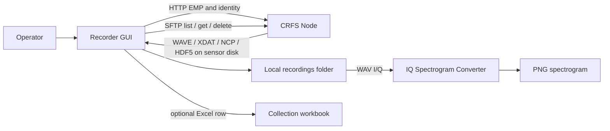
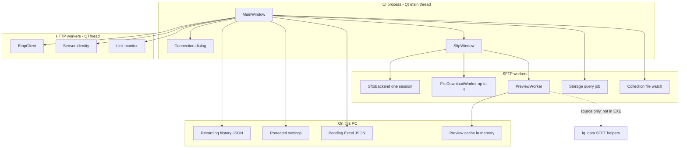
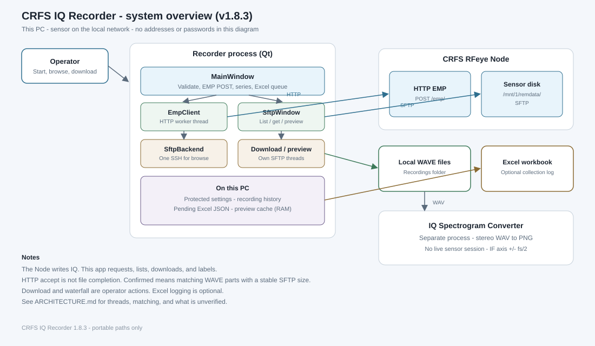
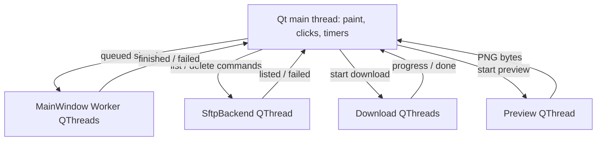
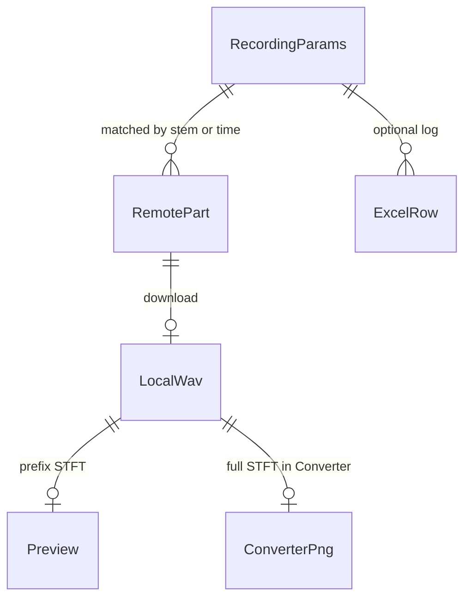

# CRFS IQ Recorder - architecture

**Version documented:** 1.16.0
**Code:** `crfs_iq_recorder/` as of this file (5 November 2026). The Excel Collection rows below (called Cellular Collection before 1.13.0) describe the 1.13.0 design; `docs/CELLULAR_COLLECTION.md` has the detail.
**Related app:** IQ Spectrogram Converter (`iq_gui.py`, `iq_data.py`) at the repository root

This note describes how the software works today. Items we could not prove from source or from a published CRFS EMP schema are listed under [Unverified](#unverified). Ideas for later work are in [Proposed improvements](#proposed-improvements) and are not current behavior.

Do not put sensor addresses, logins, or passwords in this file or in diagrams.

## System overview

CRFS IQ Recorder is a Windows desktop app. It starts an IQ capture on a CRFS RFeye Node, watches the sensor disk over SFTP, copies WAVE (or other format) files to this PC, and can append a collection row to an existing Excel workbook. It does not write IQ samples itself. The Node records; this app requests, finds, downloads, and labels.

The Converter is a separate Tk app. It turns a stereo IQ WAV (I left, Q right) into a PNG with a spectrum and a spectrogram. The two programs share a Sensorz icon and, when run from source, the Recorder's short waterfall can reuse Converter STFT helpers. They do not share a process, a settings file, or a live sensor session. The usual hand-off is a downloaded `.wav` in a local folder.

| External system | Role | How this app talks to it |
| --- | --- | --- |
| CRFS Node HTTP | Identity, connection probe, EMP recording request | `GET /`, `GET /api/node.json`, `GET /api/values/versions.json`, `POST /emp/` with HTTP Basic Auth |
| CRFS Node SFTP | File list, size, download, delete, disk free | SSH/SFTP to `/mnt/1/remdata/` (dated folders) |
| Local disk | Downloaded IQ, settings, recording history, Excel queue | Configurable recordings folder; user config under `%LOCALAPPDATA%\CRFS IQ Recorder\` for the EXE |
| Collection workbook | Field log (class, frequencies, filename, playback start) | openpyxl, or Excel COM if that workbook is already open |
| IQ Spectrogram Converter | Full PNG analysis | Offline: operator copies or points at the same WAV files |



## Component diagram





PNG copy for Confluence: [architecture-overview.png](architecture-overview.png). Mermaid source: [architecture-overview.mmd](architecture-overview.mmd).

## Component map

| Component | Responsibility | Source |
| --- | --- | --- |
| App entry | Runtime cache for the EXE; start Qt | `crfs_iq_recorder/__main__.py`, `run.py`, `paths.prepare_runtime` |
| Main window / recording controller | Shared sensor header, **Manual Recording** and **Excel Collection** tabs with one controller of the sensor at a time and a reason line on the other tab's Start (1.13.0); band and time, Start, series with Pause/Resume/Stop, status, activity log, Excel toggle, Sensor Files; restores the last tab and form, never starts on its own; buttons that start recordings are never default, take no focus on a click and react to Space only after Tab, and every request and every Excel Collection start or resume logs what triggered it (1.13.1) | `gui.py` (`MainWindow`), `start_button.py` |
| Result card | Compact "Last recording" card for both tabs: heading with the row and range, tag (Complete / Partial / Uncertain / Failed / Other range), one facts line (`1 file · 0.503 s · 251.4 MB`), one states line (recording · transfer · Excel, kept apart), a coverage note only when the sensor-reported range differs from the request, Download and Open folder (enabled only with a verified local copy; `Local copy missing` when a verified file is gone). Requested/Received/Recorded values stay in `ResultView` for logs and tests (1.16.0) | `result_view.py`, `result_card.py`, `desktop_open.py`, `recording_download.py` |
| Download destinations | Local copies mirror the sensor's dated folders: `<root>/<YYYYMMDD>[/<sub>]/<file>` derived from the remote path (never the computer's date), components vetted lexically (no `..`, separators, drive letters or reserved names; anything else falls back to the root), parts of one recording in one folder, a clash with a different file moves the recording to `<root>/<date>/<sensor serial>/` and then to a numbered name, never an overwrite; copies made by earlier versions are found in the flat root and left there (`existing_copy`, `candidate_paths`); `LocalCopies` answers a whole listing with one directory read per folder (1.16.0) | `download_paths.py` |
| Measured result | Duration, sample rate, centre and bandwidth read from the WAVE header and the CRFS `meta` trailer; result classes with a 2 % partial tolerance; nothing inferred from sizes or elapsed time (1.13.0) | `capture_measure.py` |
| Diagnostics | Short operator sentences in the activity log (a trailing "See details." is dropped at display time); rotating diagnostic log (2 MB x 5) with payloads, replies and counted sensor messages; **Copy diagnostic details** report with addresses, user folder, sensor position and stored secrets masked, reached with **Open diagnostic log** from the Activity panel's right-click menu, no buttons in the everyday view (1.16.0) | `diagnostic_log.py`, `diagnostic_report.py`, `operator_text.py` |
| Recording phases | Idle, sending, recording, waiting for files, confirmed | `recording_status.py` |
| Log sanitizer | Strip secrets from URLs, logs, and persisted objects | `sanitizer.py` |
| Remote folders | Dated `/mnt/1/remdata/` paths | `sftp_paths.py` |
| Connection settings | Host, HTTP/SFTP logins, timeout, download folder | `connection_dialog.py`, `connection_state.py` |
| Frequency plan | Integer Hz; start/end or center/bandwidth; no silent rounding | `frequency.py`, `validation.py` |
| EMP payload | One `remote_recording_scans` item; `duration` = `rate` = `capture_length` | `request_builder.py` |
| HTTP client | Identity GETs, `POST /emp/`, connection test `GET /`, link probe | `api_client.py`, `sensor_info.py` |
| Demo HTTP | In-process fake Node; no sockets | `demo.py` |
| Size estimate | `61.051 * (BW / 10 MHz) * seconds` MB; used for the label and storage gate | `size_estimate.py`, `sensor_storage.py` |
| Link monitor | HTTP reachability every 10 s; SFTP errors stay in Sensor Files. Each check, sensor-info refresh and mission-list read uses a one-shot client that closes its HTTP session on the worker thread (1.16.0: a window left open held one keep-alive socket per check, about 300 after 50 minutes) | `connection_monitor.py`, `gui.py` |
| IQ storage | SFTP `statvfs` on `/mnt/1/remdata/`; block Start if the estimate plus margin would not fit | `sensor_storage.py` |
| Recording history | Save requested Hz/time; match remote files to that Start | `recording_history.py` |
| File watch | Stable SFTP size for every recording's parts, including the parts the sensor named in its EMP stream (1.8.10: always on, not only with Excel or Repeat) | `file_watch.py` |
| Merge engine | Parse RIFF/RF64 parts and the CRFS `meta` chunk, check format/tuning/numbering/continuity, chunked byte-exact concatenation to RIFF or RF64, JSON sidecar (1.8.10) | `iq_merge.py` |
| Merge controller | Toggle state, queue, one worker thread, dedupe via `merge_history.json` and sidecars, cancel, `.partial` sweep on start (1.8.10) | `merge_controller.py` |
| Programmatic capture | `MainWindow.start_capture(CaptureRequest)` drives the same Start path as the button; `capture_finished(CaptureSummary)` reports confirmed / unknown / not_sent / sensor_error / failed; an external owner blocks manual Start and the series (1.9.0) | `capture_api.py`, `gui.py` |
| Cellular protocol import | Excel workbook/worksheet by headers (band, direction, duplex, start, stop, sensor, result columns), unit parsing, validation, result rows recognised by key and never reimported, versioned snapshot (1.9.0, simplified 1.10.0) | `cellular_protocol.py` |
| Sensor capability | What the model number says (tuning range, instantaneous bandwidth, sample-rate tiers), for a warning before Start and the size estimate only; it never changes a request (1.13.0; 1.10.0-1.12.0 used it to split rows) | `cellular_capabilities.py` |
| Cellular plan | Worksheet order, one request per row with the row's own start/stop and the app's duration, per-task storage estimate, `legacy` flag for plans saved by 1.10.0-1.12.0 (never continued) (1.13.0) | `cellular_plan.py` |
| Cellular schedule | Run now with a repeat count (0 = until stopped) or times of day (dates or daily); local time; due / delayed / missed classification; round IDs (1.9.0, 1.10.0) | `cellular_scheduler.py` |
| Cellular runner | QObject controller: idle check before every request, one capture at a time, wait after confirmed finalization, Pause/Resume/Stop, task states, persisted session, restart reconciliation (nothing resent blindly), a pass whose time went by while the app was closed is listed as missed and never started on its own - also after Continue (1.12.0), bounded download queue, checksums, quality checks, the workbook queue (1.9.0+); pass counts and **Retry failed rows** (reconcile first, failed rows only, new attempt, nothing re-sent on its own); a new collection waits for the last one's downloads, and a restart offers unfinished downloads of a finished collection (Continue only downloads) (1.13.0) | `cellular_runner.py` |
| Cellular manifests | Versioned JSON manifest beside each logical capture; session handover JSON + Markdown with counts kept apart (1.9.0) | `cellular_manifest.py` |
| Cellular workbook | Cell-level writer for the protocol worksheet: block 0 filled in place, later passes appended as blocks, backup before the first change of a session, persistent `WorkbookQueue` with busy/error retries, openpyxl or Excel COM when the workbook is open (1.10.0) | `cellular_workbook.py`, `excel_com.py` |
| Cellular quality | Pre-run checks, post-download WAV validation sampling begin/middle/end, sampled preview PNG with an absolute RF axis only from file metadata and labelled requested start/stop markers (`PreviewAxis`, 1.15.0), coverage summary (1.9.0) | `cellular_quality.py` |
| Cellular preflight | Background pre-collection check before every pass and after a restart: sensor identity against the plan, clock offset (`EmpClient.fetch_sensor_clock`), sensor and local storage with reserve, destination writable, plan values, workbook open/closed/busy/missing; blocking checks pause the pass with the reason, a missing or busy workbook only queues results (1.15.0). The same checks back the panel's **Check readiness** button (`CellularRunner.readiness_check`): one line, blocking vs temporary Excel unavailability kept apart, never starts a recording (1.16.0) | `cellular_preflight.py`, `cellular_runner.py` |
| Excel COM states | Tri-state workbook probe (`excel_workbook_state`: open/closed/busy) and `com_busy_reason` (RPC_E_CALL_REJECTED, RPC_E_SERVERCALL_RETRYLATER, cell edit mode 0x800AC472); a save counts only when `Workbook.Saved` is true; the results sheet of an open log workbook is added through Excel (`add_worksheet_com`) (1.15.0); `activate_workbook` brings a workbook the running Excel holds to the front for **Open written Excel file**, whose target is the workbook the queue last wrote (`WorkbookQueue.written_workbook`, persisted, independent of the workbook currently chosen) (1.16.0) | `excel_com.py`, `cellular_workbook.py`, `cellular_excel.py` |
| XDAT header | Reads the `.xhdr` the Node writes beside each `.xdat` (sample count/rate, centre, bandwidth, `start_capture`, layout) into a `PartInfo` so measurement, verification, quality checks and previews treat XDAT like WAVE; decodes only the layout the header states (int16 interleaved I/Q), reports anything else as not decoded (1.15.0) | `xdat_header.py`, `capture_measure.py` |
| Cellular panel | The Excel Collection tab (1.13.0): header with state badge, lazily built form, action bar pinned under the tab, plan preview, result card, pass summary with Retry failed rows, recovery notice (interrupted session: Check with the sensor / Continue / Skip uncertain; missed pass: Run now / Skip; unfinished downloads: Continue) | `cellular_panel.py`, `cellular_pickers.py` |
| Sensor Files window | Listing, sort, groups, download, delete, waterfall; requested (**Req.**) and recorded columns side by side, recorded values from what was read from each file (1.14.0); **Local copy** column per file and group (Saved / Queued / Downloading with speed and time left only once measured / Waiting to retry / Verified / Failed), right-click Retry download / Open folder / Copy filename, selection count and total size, downloads into the mirrored dated folder, selection, scroll and expanded groups kept across refreshes, Ctrl+C copies names only inside the table (1.16.0) | `sftp_window.py`, `file_measurements.py`, `download_paths.py` |
| SFTP backend | One listing thread and one SSH session for browse/delete | `sftp_window.py` (`SftpBackend`) |
| SFTP client | Paramiko connect (8 s), read (20 s), download via `.part` | `sftp_client.py`, `download_util.py` |
| Listing groups | `_0001` / `_0002` as one capture; NEW badge | `listing_sort.py` |
| Waterfall preview | First ~0.8 MB of a WAVE or XDAT (headerless prefix decoded at the `.xhdr` rate); STFT computed once off the UI thread into a `WaterfallData` array (dB values, colour rows, colour bar, absolute axis and capture start when the metadata gives them, requested range) | `spectrogram_preview.py`, `iq_wav.py` |
| Waterfall view | `WaterfallView` widget (1.16.0): wheel zooms the time axis at the pointer (`TimeWindow`, bounded to 64x / 4 columns), drag pans (clamped), Reset / Home restores; cursor readout of local time (file start + offset), RF frequency and dBFS/bin from the array; requested range markers and hatched *not recorded* ranges (`coverage_of`); the scene is rendered once per view change into a cached pixmap at the device pixel ratio, mouse moves only redraw the crosshair; handler timings kept in `timings` / `max_timings` | `waterfall_view.py` |
| Excel log | Queue, backup, merge split names, COM or openpyxl; flushed on a worker thread (1.8.8) | `excel_log.py`, `excel_writer.py`, `excel_com.py` |
| JSON state files | Atomic temp-file + replace writes, `.bak` fallback on a corrupt file (1.8.8) | `json_store.py` |
| Collection catalog | Workbook classes, worksheets, frequency styles | `collection_catalog.py`, `class_match.py` |
| Secrets | Windows DPAPI (`CryptProtectData`); Base64 elsewhere | `secrets_store.py` |
| Theme | Dark/light shared look | `theme.py` |
| Worker thread registry | Track every QThread; orderly stop before exit | `worker_threads.py` |
| Packaging | Bundle signature report, Inno Setup installer, blocked-PC diagnostics | `packaging/` |
| Converter GUI | Folder pick, RBW, batch PNG | `iq_gui.py` |
| Converter DSP | Chunked STFT, spectrum + spectrogram PNG | `iq_data.py` |

## Recording workflow

Clicking **Start Recording** always builds a payload, stores history, and POSTs EMP. Confirming files, Excel, Repeat, download, and preview are separate. Download never starts by itself.

```mermaid
sequenceDiagram
  actor User
  participant UI as MainWindow
  participant Hist as Recording history
  participant HTTP as EmpClient
  participant Node as CRFS Node
  participant SFTP as SFTP listing
  participant XL as Excel queue

  User->>UI: Start Recording
  UI->>UI: Validate Hz and time
  UI->>UI: Storage gate from last IQ Storage snapshot
  opt Excel logging on
    UI->>UI: Require workbook, class, worksheet
  end
  UI->>Hist: Save requested start/end/center/BW/duration
  UI->>HTTP: POST /emp/ one scan
  HTTP->>Node: remote_recording_scans
  Note over UI: Local timer = recording seconds + 0.4 s
  Node-->>HTTP: HTTP accept or timeout
  UI->>UI: Phase Recording then Finalizing
  Node-->>HTTP: SSE: file named per part, then recording finished
  UI->>SFTP: Poll dated remdata folders (always)
  SFTP-->>UI: Named parts present with stable size
  UI->>UI: Confirmed; otherwise says which named file is missing
  opt Excel logging on
    UI->>XL: Enqueue one row per new part, merge by group
  end
  User->>SFTP: Download selected files optional
  User->>SFTP: Click WAVE for waterfall optional
```

### What happens on Start

1. **Validate** - integer Hz, even bandwidth in center mode, recording time copied to `duration`, `rate`, and `capture_length`.
2. **Storage gate** - empirical estimate vs last SFTP free-space snapshot (15% or 32 MB extra). Does not delete sensor files.
3. **Excel gate** (optional) - workbook path and a unique class/worksheet mapping.
4. **History** - `RecordingParams` with the typed window, duration, host, sensor serial if known, collection fields if Excel is on.
5. **POST** - `task_id` like `iq-YYYYMMDD-HHMMSS`. Format from the combo (WAVE default).
6. **Timer** - UI phase moves to Recording. When the timer fires, HTTP is treated as finished even if the POST is still open (`client.close()`, late replies ignored).
7. **After elapsed**
   - **Collection watch** if Excel or Repeat is on: SFTP poll every 2 s; a part is "finalized" after two listings with the same size and 8 s with no growth; give up 60 s after elapsed if nothing settles.
   - **Sensor Files open**: refresh after 3 s and 12 s; confirm after 2 / 6 / 14 s if matching sizes are unchanged.
   - **Otherwise**: tell the operator to open Sensor Files. HTTP accept is not file-done.

Repeat (count or until stopped) waits after the current capture (default 5 s). **Stop after current recording** finishes that capture or cancels the countdown. Consecutive tasks are not gapless IQ.

### Independent actions

| Action | Trigger | Notes |
| --- | --- | --- |
| Sensor Files | Button | Own window and SFTP session |
| Download | Selection + Download | Up to four files at once; a file already saved with the sensor's size is skipped; never overwrites another file (a clash moves the recording to a sensor subfolder, then to `name (2).wav`); saved into `<root>/<YYYYMMDD>/` like the sensor (1.16.0) |
| Waterfall | Click a WAVE or XDAT; wheel / drag / Reset on the picture | Prefix only; quiet start does not mean a quiet file; zoom and pan never re-read the file |
| Delete remote | Delete key on the list | Sensor files only; local copies and Excel stay |
| IQ Storage | Connect, timer 30 s, after record/delete | Separate SFTP from Sensor Files |
| Link badge | Every 10 s | HTTP only |
| Excel flush | After enqueue and every 15 s | Retries if Excel has the book locked |

## Background processing

One OS process. No worker subprocess. Qt main thread owns widgets. Network and STFT run on `QThread` workers. Converter conversion (other EXE) uses a Python `threading.Thread`.



| Work | Thread | Timeout / cancel | Error handling |
| --- | --- | --- | --- |
| Paint, tables, dialogs | UI | - | - |
| EMP POST, identity, link probe | `Worker` QThread | HTTP timeout from Settings (default 30 s); link probe 4 s | Log; recording failure stops the series |
| SFTP list / mkdir probe / delete | `SftpBackend` | Connect 8 s, read 20 s; abort closes the SSH socket | Empty-state text "Could not list files" plus the error; no modal for list failure |
| Download | One QThread per file, max 4 | Cancel event; `.part` cleaned up; waits up to 10 min for the sensor to accept a connection (1.14.0) | Status + per-file warning; one message for files the sensor never accepted a connection for |
| Waterfall | QThread; matplotlib under a semaphore of 1 | Cancel; temp prefix deleted | Caption error; cache skipped |
| Collection watch / IQ Storage | `Worker` QThread, new SFTP each time | Cancel event on the previous job | Log; last good storage kept as stale |
| Excel write | UI thread calling COM or openpyxl | Busy → stay in queue | Pending count on the main window |
| Close Sensor Files | UI returns at once | Workers kept until `finished` | Late preview results dropped by token |

**Shared resources that can stall the UI**

- Matplotlib is serialized (`_PREVIEW_COMPUTE`). A preview still should not run on the UI thread.
- Sensor Files listing uses one Paramiko session. A slow `listdir` blocks other list/delete commands on that same backend thread, not the UI.
- IQ Storage and collection watch each open **another** SSH session. Several connects at once can slow the Node or hit the 8 s connect timeout (that is what "SFTP connection failed: timed out" is). Over OpenVPN the Node 100-18 also stopped accepting new SSH connections for ~15 s after about six in ten seconds; since 1.14.0 new connections are paced process-wide (3 per 10 s) and, after a connect timeout, held back for 20-60 s (`sftp_client.ConnectPacer`).
- EMP POST close-on-timer avoids waiting for HTTP, but a stuck TCP send is not fully characterized here ([Unverified](#unverified)).
- Excel COM runs on the UI thread. A hung Excel automation call would freeze the window until it returns.

Tokens (`_record_gen`, `_info_token`, `_link_token`, `_watch_token`, `_storage_token`, `_preview_token`) drop late results after a new action.

**Shutdown.** Every worker `QThread` is registered in `worker_threads.py` when it starts. After `app.exec()` returns, `gui.run()` calls `stop_worker_threads()`: abort each worker, `quit()`, wait up to 8 s in total, and leak (never delete) any thread that is still blocked, then skip interpreter teardown. Before 1.8.6 Python deleted running `QThread` objects at exit, which Qt treats as fatal (`QThread: Destroyed while thread is still running`, Windows exit code 0xC0000409) - the Application-log crash on every close of 1.8.5. `tests/conftest.py` does the same at session end.

## Data and metadata

There is no CRFS WAVE RF chunk in the files we have inspected for this app. Labeling comes from **this PC's history**, matched onto remote names.



| Object | Identity | What it stores |
| --- | --- | --- |
| Recording task | UUID `id`; `task_id` on the Node is separate (`iq-YYYYMMDD-HHMMSS`) | Requested start/end/center/bandwidth Hz, duration s, host, `started_at`, optional class/worksheet/sensor serial |
| File part | Remote path, e.g. `.../file_122236_0001.wav` | Size, mtime from SFTP; `_0001` is a size split, not a frequency tile |
| Group | `iq_group_key(name)` (stem without `_NNNN`) | All parts of one capture; parent row in Sensor Files; one Excel row |
| Excel row | `sensor_id` + remote path (and group merge) | Typed Freq Start/Stop, class, filenames, Playback Start as `N seconds` |
| Preview | `(path, size, mtime, requested_start_hz, requested_stop_hz)` | Last 8 waterfall arrays in that Sensor Files window |

**Requested vs recorded**

- **Requested:** values on Start (and in history, Sensor Files **Req.** columns, Excel Freq Start/Stop). The EMP `bandwidth` field is sent as typed. 1.8.3 does not clamp it to instantaneous bandwidth.
- **Verified on disk:** WAVE `fmt` sample rate, sample count and CRFS `meta` centre/bandwidth, read at confirmation, preview or download and kept per sensor path in `.crfs_iq_recorder_file_measurements.json` (Sensor Files **Recorded** columns and the result card; *unknown* when not read at the file's current size) (1.14.0). The waterfall X axis is baseband `±fs/2`, not the typed MHz window, unless the operator reads the history columns.
- **Class band** in the workbook is wider than one capture. Excel is filled with the **typed capture window**, not the whole class.

Matching: prefer a remembered `iq_stem`; otherwise the lead part's timestamp must fall in `[started_at - 180 s, started_at + duration + 180 s]`. One recording maps to at most one group. Host is a weak preference so an IP change does not drop metadata.

## Persistence and recovery

| Store | Location (EXE) | Location (source) | Survives restart |
| --- | --- | --- | --- |
| Settings + DPAPI secrets | `%LOCALAPPDATA%\CRFS IQ Recorder\.crfs_iq_recorder_settings.json` | next to `crfs_iq_recorder/` | Yes. Plaintext password keys are stripped on load. |
| Recording history | `.crfs_iq_recorder_recordings.json` in the same folder | same pattern | Yes, last 2000 rows. No passwords. |
| Excel queue + logged keys | `.crfs_iq_recorder_excel_log.json` | same | Yes. Flush on a 15 s timer and at startup. |
| Workbook backup | `*.crfs-backup-*` next to the `.xlsm` | same | Yes, before the first write |
| Downloads | Settings folder, default `%USERPROFILE%\CRFS IQ Recorder\Recordings`, one subfolder per sensor date (`20261104\`) since 1.16.0; older flat copies recognised in place | configurable; cloud paths remapped to local | Yes |
| Preview cache | Memory in `SftpWindow` | - | No |
| Matplotlib cache | `%LOCALAPPDATA%\CRFS IQ Recorder\cache\matplotlib` | unused unless frozen | Yes |
| Converter settings | `.iq_gui_settings.json` next to the Converter | same | Separate app |
| Demo SFTP | In-memory | - | No |

Settings, recording history and the Excel queue are written through `json_store.write_json`: the document goes to `<name>.<pid>.tmp` and is moved over the live file (`os.replace`), and the previous document is kept as `<name>.bak`. A kill or power loss mid-write therefore leaves the old or the new file, never an empty one; if the live file is unreadable at startup the `.bak` copy is loaded instead and the next save repairs the live file.

After a disconnect: the header goes Checking, then Reconnecting... (one missed HTTP check), then Disconnected (two). It returns to Connected when probe succeeds. SFTP timeouts stay in Sensor Files. Reopening Sensor Files starts a new SSH session. Pending Excel rows retry until the workbook is writable. History still matches files after an IP change if stems or timestamps line up.

Crash during download leaves a `.part` file; the next successful download finalizes a unique name.

## Converter integration

| | Recorder preview | Converter |
| --- | --- | --- |
| App | Same EXE, Sensor Files pane | Separate EXE / `iq_gui.py` |
| Input | SFTP prefix, max 786,432 bytes, 131,072 samples | Whole WAV, chunked |
| Plot | Waterfall only, 256-point FFT, jet | Spectrum + spectrogram, RBW-based FFT |
| Axis | Baseband `±fs/2` | Same IF axis (not EMP MHz) |
| Shared code | Imports `iq_data` helpers when **not** frozen; EXE uses a local STFT copy | `iq_data.py` |

Typical field path: Recorder download folder → copy or save into the Converter input folder (this repo's launchers use `IQ Collection` / `IQ Results` next to the Converter). Folders are settings, not hardcoded drive letters in shared code.

## Build and distribution

**Recorder**

1. `build_exe.bat` creates `.venv`, installs `requirements.txt` and PyInstaller, runs `CRFS_IQ_Recorder.spec`.
2. One-file windowed EXE: `crfs_iq_recorder/dist/CRFS_IQ_Recorder.exe`. Entry `run.py`. Runtime hook `pyi_rth_crfs.py`. The spec bundles only QtCore/QtGui/QtWidgets and their plugins, matplotlib Agg, numpy, paramiko, requests, openpyxl, and pywin32; it embeds the Sensorz icon and a Windows version resource built from `__version__`.
3. Startup cost of a one-file EXE is mostly unpacking to `%TEMP%`; keeping the bundle small is the main lever. In code, `requests` and `openpyxl` import on first use, and sensor, storage, link, workbook, and Excel work starts after the first frame (`MainWindow._start_background_init`).
4. Authenticode signing: when `CRFS_SIGN_ARTIFACT_METADATA` (Azure Artifact Signing), `CRFS_SIGN_THUMBPRINT` or `CRFS_SIGN_PFX` is set, the spec signs every bundled DLL/PYD (copies under `build\signed_binaries`) and `build_exe.bat` signs the EXE and the installer through `sign_exe.ps1`. Smart App Control checks each loaded file, so the outer EXE alone is not enough. Certificates, tokens and account metadata stay outside the repository; `.signing-tools\` (downloaded signtool and plug-in) is git-ignored. `packaging\verify_bundle_signatures.py` reports the status of all ~90 files.
5. Installer: `CRFS_BUILD_INSTALLER=1` adds a folder build (`CRFS_BUILD_ONEDIR=1`, `COLLECT`) and compiles `packaging\CRFS_IQ_Recorder.iss` with Inno Setup into `dist\CRFS_IQ_Recorder_Setup.exe` (Program Files, Start menu, uninstaller, silent switches). It exists because AppLocker/WDAC path rules on managed PCs forbid running from `%TEMP%`, where the one-file EXE unpacks. Its `[Code]` section warns before installing into a folder guarded by Defender's Controlled folder access (Documents, Desktop, Pictures, ...) and explains a blocked uninstall, because an unknown uninstaller cannot delete files there.
6. Git does not store the EXE. Tag `vX.Y.Z` must match `__version__` in `crfs_iq_recorder/__init__.py` and Quick Start **Version**.
7. GitHub Release on `ItayHararii/iq-spectrogram-converter` holds the EXE (and the installer). Older tags stay for rollback. This branch publishes with remote `personal`. Do not force-push `main` or tags.
8. Which Windows mechanism blocks a given PC (SmartScreen, Smart App Control, WDAC, AppLocker, ASR) and the signing decision are in [DISTRIBUTION.md](DISTRIBUTION.md); `packaging\diagnose_block.ps1` collects the evidence on the affected PC.

**Converter**

- `build_exe.bat` at the repo root and `IQ_Spectrogram_Converter.spec` → `dist/IQ_Spectrogram_Converter.exe`.
- Converter version is `__version__` in `iq_gui.py` (1.3.0 at the time of this note).

Never commit credentials, `*.wav`, collection workbooks, Excel backups, or EXEs.

## Unverified

- EMP JSON response body and any completion or cancel URL. Public CRFS docs and the in-repo research note do not define them. This app does not call `/emp/status`.
- Meaning of EMP `rate` and `capture_length` beyond "same number as recording seconds" as sent.
- Whether the Node records the full requested RF span when it is wider than instantaneous bandwidth. History and Excel still store the request. WAVE `fs` is the way to see what was stored.
- Exact analog 3 dB IBW vs datasheet 40 / 100 MHz.
- XDAT / NCP / HDF5 on-disk layout and sample rate vs WAVE.
- Whether Site or DeepView plots EMP `bandwidth` as the waterfall axis for these WAVE files.
- That `requests` always honors the Settings timeout on a blocked EMP POST (scripted POSTs have hung in lab use).
- SFTP account names on a given Node (HTTP and SFTP are different logins; defaults exist in code and must not be pasted into shared docs).

## Proposed improvements

Not implemented. Highest value first for responsiveness, then reliability, then maintainability.

1. **One SFTP client for browse, storage, and watch** - or a short queue. Parallel connects are the main timeout we see in Sensor Files.
2. **Keep EMP POST off the UI path and bound the socket** - timer already closes the client; confirm the send cannot block a worker forever.
3. **Show requested vs recorded coverage** - keep the POST as typed; label estimate, Sensor Files, Excel, and waterfall from WAVE `fs` / model IBW when they differ.
4. **Replace the 61.051 MB rule** with the measured WAVE DDC bins so storage gating matches file size.
5. **Excel writes off the UI thread** with the same pending file.
6. **Bundle Converter STFT in the Recorder EXE** so preview matches Converter in frozen builds.
7. **Drop unused listing thread work when the window is hidden**; cap preview jobs at one in flight (already one matplotlib lock).
8. **Document WAVE-only preview** in the UI when the format is not WAVE.

Lab scripts under `crfs_iq_recorder/tools/` are not part of the product EXE and are not this architecture.
