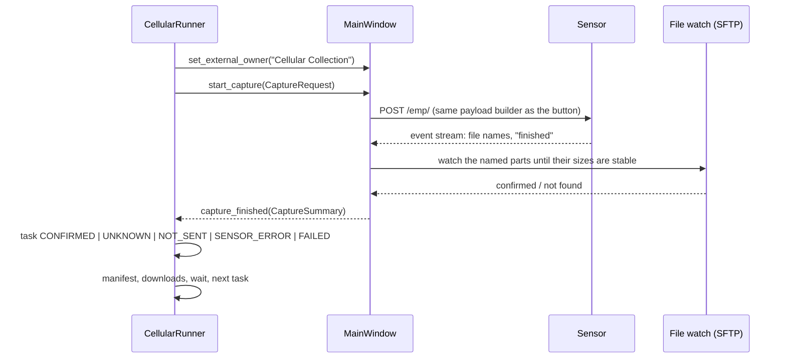

# Cellular Collection - how it works (developer report)

**Version:** CRFS IQ Recorder 1.9.0 (November 2026)
**Operator guide:** the "Cellular Collection" section of the [Quick Start](confluence/CRFS_IQ_Recorder_Quick_Start.md).
**QA:** `QA_REPORT.md` at the repository root, Part C.

Cellular Collection records every allocation listed in a protocol workbook in a fixed order, optionally at selected times of day, and leaves traceable IQ behind: a manifest beside each capture, rows in the collection workbook, and a handover summary per session. It lives inside the existing Recorder and reuses its recording path, SFTP download, Excel queue, merge engine and worker-thread registry. Nothing in the manual recording flow changed for operators who do not open the panel.

Do not put sensor addresses, logins or passwords in this file.

## What was reused and what was added

| Existing component | Reused for |
| --- | --- |
| `MainWindow` recording path (`_on_start`, EMP stream, file watch, `recording_status`) | Every cellular capture is a normal recording, started through `MainWindow.start_capture(CaptureRequest)` and confirmed by the same file watch that confirms a manual recording. |
| `FileDownloadWorker`, `_open_browser` (SFTP) | Parts are copied with the same `.part` download and the same handshake gate. |
| `ExcelLogStore`, `pending_from_row`, `flush_excel_queue`, `excel_writer` | Cellular rows go through the same persistent queue, backup-before-first-write and "Pending Excel updates" retry. |
| `iq_merge` + `merge_controller` | Optional merge of split parts, originals kept, sidecar written. |
| `sensor_storage.query_iq_storage`, `sensor_info.SensorInfo` | Pre-run checks and the storage gate. |
| `spectrogram_preview` STFT helpers | Sampled previews (beginning, middle, end). |
| `json_store`, `worker_threads.track_worker_thread` | Crash-safe state files; orderly thread stop at exit. |

| New module | Purpose |
| --- | --- |
| `capture_api.py` | `CaptureRequest` / `CaptureSummary` and the outcome vocabulary shared by the GUI and the runner. |
| `cellular_protocol.py` | Workbook import by headers, unit parsing, validation, duplicate/overlap flags, result-row detection, column mapping, versioned snapshot. |
| `cellular_capabilities.py` | Sensor capability model: IBW, conservative capture window, coverage checks, sub-band splitting. |
| `cellular_plan.py` | Ordered task list with windows, durations and storage estimates. |
| `cellular_scheduler.py` | Run-now / times-of-day schedule, explicit time zone, round IDs, due / delayed / missed classification. |
| `cellular_runner.py` | The controller (QObject): task state machine, waits, Pause/Resume/Stop, persistence, recovery, downloads, checksums, quality checks, Excel, manifests, handover. |
| `cellular_manifest.py` | Capture manifest and handover JSON / Markdown. |
| `cellular_excel.py` | Row construction and the `Cellular Results` sheet. |
| `cellular_protocol_results.py` | Results written back into the protocol workbook: one `Round <date> <time>` sheet per round (1.9.1). |
| `cellular_quality.py` | Pre-run checks, WAV validation, sampled preview, coverage summary. |
| `cellular_panel.py` | The collapsible panel and its dialogs. |
| `cellular_reference.py` | Template workbook writer with reference-chart allocations marked "verify before use". |

## Capture path (completion and recovery first)

- `MainWindow.start_capture` returns a reason string when it cannot start (manual recording running, series active, invalid plan, storage gate) and otherwise emits exactly one `capture_finished` for the request, including on every failure path (`_fail_recording`, stream errors, "sensor finished but no file").
- The **external owner** blocks the manual **Start Recording** button and the Repeat series while a session owns the sensor; the runner refuses to start while a manual recording is active. One sequence controls the sensor at a time.
- Outcomes are kept apart: *confirmed* (files found and stable), *unknown* (request reached the sensor, result not proven - never counted as collected, never resent automatically), *not_sent* (nothing reached the sensor - one automatic retry), *sensor_error* (the sensor refused), *failed*. A finished round with uncertain or failed tasks is *partial*, not *done*.
- The **wait** between tasks starts only after the capture is confirmed and finalized (file sizes stable), so the sensor is never asked to record while it is still closing a file.
- **Downloads start from a fresh listing.** On the R40-8 the sensor still touches a recording a few seconds after it has reported *finished* and the sizes have stopped changing: a WAVE part grows by its 648-byte trailer, and an XDAT recording gets its `.xhdr` sidecar late and a longer `.xmrk`. The runner therefore waits `FINALIZE_SETTLE_S` (5 s) after confirmation, lists the folder again on a worker, adds files of the same stem that appeared late (noted in the manifest), records both `size_listed_at_confirmation` and the final `size`, and only then queues the downloads. If the second listing fails, the files are downloaded as listed at confirmation and the manifest says so.
- **Recording format.** The panel's *Recording format* (Advanced) defaults to *Same as recorder*; the format actually sent is stored in the capture summary, the task state and the manifest (`recording.recording_format`, `recording.encoding`). Content checks, duration measurement and previews apply to WAVE; other formats are downloaded and checksummed and the quality level is `not_checked` (not an error). The pre-run checks and the plan preview show the effective format.
- **Persistence:** `cellular/session.json` under the config folder holds the plan, rounds, task states, file states and settings; it is rewritten atomically after every change. On start the runner loads it and, if the previous process died mid-session, shows the session as *interrupted* with the uncertain tasks listed. **Reconcile with sensor** lists the dated folders over SFTP and confirms a task only from files the recording history can attribute to it; nothing is resent until the operator chooses **Resume session**, **Skip uncertain** or a retry. A reconciliation whose SFTP listing fails reports the failure and changes nothing. **Resume session** also re-queues downloads that were pending or running when the process died.

## Import and sequence

- Headers are matched by role (band, nominal, duplex, direction, start, stop, centre, bandwidth, duration, repeat, notes, result columns: recording name and recording date & time). Units come from the cell (`758 MHz`), the header (`Start (MHz)`) or a default chosen in the mapping dialog, in that order. Two layouts are supported: one row per direction, and one row per band with paired DL/UL columns.
- A band cell that starts with a frequency (`700 MHz (B68 / B28)`) keeps its text as the band label and uses the leading frequency as the nominal for ordering; the label is not doubled with "(700 MHz)".
- Worksheets are read to their end. Workbooks written by some tools carry no `<dimension>` element, which made openpyxl's read-only `max_row` `None` and, in 1.9.0, imported zero rows from such a protocol; the blank-row run limit now bounds the scan instead (1.9.1).
- Validation refuses reversed, missing or contradictory edges, unknown directions and out-of-range frequencies; every refused row is listed with its row number and the plan stays disabled. Duplicates are flagged and collapsed; overlaps are flagged. Rows carrying results (filename, snapshot id, playback time) are reported and never imported as instructions.
- The snapshot of the imported protocol (`cellular/protocols/<hash>.json`) is what a session runs; editing the workbook afterwards changes nothing until **Reload**.
- Ordering: bands ascending by nominal frequency; within an FDD band every DL window, then every UL window; TDD bands once as "TDD / shared UL-DL". The reference facts used for tests (nominal order, FDD/TDD per band) are in `cellular_reference.py`; the workbook, not the reference, decides the allocations.
- Wide allocations are split into consecutive windows of the capture width (20 MHz default, even widths, 1 Hz widening of odd edges reported). Windows step from the allocation's start edge by the usable width and the last window is moved back onto the stop edge, so edges stay on the protocol's own grid (1805–1825, 1825–1845, 1845–1865, 1860–1880 MHz for B3 DL; the overlap of the last window is recorded) instead of fractional MHz. Each window is a separate task with its own manifest, Excel row and files; the manifest's coverage reads `window 2 of 4 (sequential coverage, partial capture)` next to the whole-allocation extent, so partial captures are identifiable. Nothing is cropped, retuned or resampled silently.
- Sensor capability is a model, not a measurement: `cellular_capabilities.py` states the IBW from the model string and keeps "sustained gapless" apart from "instantaneous"; the panel's capture-window note says when no gapless figure has been verified for the model.

## Scheduling

Schedules are stored as times of day plus dates (or daily) with an explicit zone (`local` or `UTC`); occurrences are materialised in UTC. A round that becomes due while the sensor is busy is *delayed* and keeps its scheduled time in its ID and manifests. A round whose window passed while the app was not running is *missed*; it is listed and only runs when the operator presses **Run missed round now**. `tight_schedule_warning` compares the estimated round length against the spacing of the schedule before the session starts.

## Background work

All waiting, downloading, hashing, checking and rendering runs off the UI thread: `QThread` workers tracked by `worker_threads`, signals delivered with queued connections, bounded by `MAX_DOWNLOADS` (2) parallel downloads, a backlog limit that pauses new captures (with the reason shown), a local-disk reserve, and one quality check at a time (previews are drawn with matplotlib's object-oriented Agg API under a lock; pyplot is not thread-safe). The runner's timer tick (`TICK_MS`, 0.5 s) drives waits and schedule checks; nothing blocks.

The panel itself is cheap while closed: only the header row (toggle and status chip) exists until the operator opens it, or until a saved, interrupted or finished session is found at start, when `_ensure_built` creates the body. The main window therefore keeps the same widget count as 1.8.10 for operators who never use the feature.

## Metadata, Excel, quality

- Manifest `<stem>.cellular.json` (schema 1) beside the parts: identifiers (campaign, site, visit, round, task, protocol version, record id), the allocation (workbook values and the actual window), timing (scheduled, started, finished, requested vs held duration), sensor identity and GNSS/time status (`unknown` when not provided), file list with sizes and SHA-256, quality flags, Excel status, notes. The EMP `rate` field is never reported as a sample rate; the model sample rate is labelled `sample_rate_hz_model`.
- Excel: the matching class worksheet when the catalog has one, otherwise `Cellular Results` (created once, after the usual backup). Split parts of one capture are one row; separate windows are separate rows; a locked workbook defers the row and the tick retries.
- Protocol workbook results (1.9.1, `cellular_protocol_results.py`): when the protocol has a result column (`IQ Recording`, `Recording Date & Time`, …) and *Advanced → Fill the protocol workbook* is ticked (default), every round gets its own worksheet in the protocol workbook, named `Round <scheduled local date> <HH-MM>` (` (2)` when the name exists from an earlier session). The sheet copies the protocol header (texts, styles, widths, frozen pane) and holds one row per planned window in plan order: the protocol row's own cells, the window actually recorded in the start/stop columns (the whole-allocation extent is in the appended **Window** column), the sensor that recorded in the protocol's sensor column, the part file names one per line in the result column, the held seconds in the duration column, the local capture start as a real Excel datetime (`dd/mm/yyyy hh:mm:ss`) in the date & time column, and appended **Window / Status / Notes / Round** columns (the protocol's own Status column is used when it has one). A window that was not recorded keeps its result cells empty and says `not recorded`, `skipped by the operator` or `uncertain — not counted as collected`. The sheet is rewritten from the session state whenever a task, download, checksum or file check changes (writes are coalesced to one every few seconds and run on a worker); the protocol sheet and earlier round sheets are never modified; a `.crfs-backup-<stamp>` copy is made before the first write of a session; saving goes through a temporary file and `os.replace`, so a failed save leaves the workbook as it was; an open-in-Excel or locked workbook defers the write (`ExcelBusyError`, retried every 15 s, logged once) and the panel shows *deferred* next to the sheet name. An Excel table with the protocol table's style covers the round sheet so it can be filtered. Tested against a copy of the field protocol (embedded chart image, data validations and the `CellularProtocol` table survive openpyxl's round trip; Excel opens the result without repair).
- Quality: pre-run checks (connection, identity, clocks, GNSS when known, sensor and local storage, plan, test capture) are shown with the plan before Start. After download, `validate_capture` checks RIFF headers, sample format, part numbering and time continuity (`meta` chunk), tuning and bandwidth against the plan, held duration, and samples at the beginning, middle and end (clipping, zero runs, DC, level jumps). Previews are three small waterfalls from those blocks and say "Sampled preview (not the whole file)". Original IQ is never modified.
- Handover: `cellular_manifests/handover_<campaign>_<time>.json` and `.md` list every capture with its files, sizes, checksums, quality level and Excel status, and count logical captures, files, derived images and merged outputs separately; captures in a non-WAVE format are listed under *Content not inspected*, not as quality warnings. The handover is written when the session ends and again when the last background download or check finishes. Nothing is uploaded anywhere; originals stay until the transfer is verified by whoever receives them.

## Tests

`tests/test_cellular_*.py` (72 tests) cover: both workbook layouts, units, duplicates and result rows; a workbook without `<dimension>` tags; ordering, TDD, sub-band splitting with whole-MHz window edges; the protocol-workbook results sheet (creation from the protocol's header and styles, idempotent rewrite, earlier round sheets untouched, same-minute rounds getting their own sheet, paired layouts, locked workbook deferral with no temp file left, the runner writing round by round with a deferred first write, the panel end-to-end on the demo transport); time zones, delayed and missed rounds; waits after confirmation, Pause/Resume/Stop in every state; interrupted sessions, reconciliation from sensor files, no blind resend, pending downloads re-queued after a restart; backlog and low local storage pauses; locked workbook deferral; connection loss as *unknown*; midnight folder change; the fresh listing before downloads (late sidecar files, grown sizes, listing failure); manifests and handover counts, including the recording format and *not checked* captures; WAV validation and previews, non-WAVE files reported as not inspected rather than corrupt; the panel end-to-end on the demo transport, including the manual Start lock and the format choice; the collapsed panel building nothing until opened and opening itself for a saved session. Hardware results are in the QA report.
