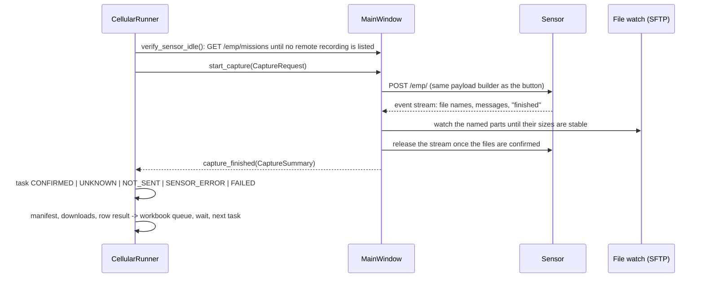

# Cellular Collection - how it works (developer report)

**Version:** CRFS IQ Recorder 1.12.0 (November 2026)
**Operator guide:** the "Cellular Collection" section of the [Quick Start](confluence/CRFS_IQ_Recorder_Quick_Start.md).
**QA:** `QA_REPORT.md` at the repository root, Parts D and E.

Cellular Collection records the frequency ranges listed in a protocol workbook, row by row and in worksheet order, waits between recordings, and repeats the whole list (back to back or at scheduled local times) so activity can be compared at different hours. It fills the protocol's own result cells and nothing else. It lives inside the existing Recorder and reuses its recording path, SFTP download, merge engine and worker-thread registry. Nothing in the manual recording flow changed for operators who do not open the panel.

1.10.0 replaces the 1.9.x design (campaign/site/scenario fields, per-round `Round <date> <time>` worksheets with Window/Status/Notes/Round columns, the `Cellular Results` sheet, the UTC/local selector, the mapping and template dialogs). Older workbooks keep whatever those versions wrote; nothing is deleted.

Do not put sensor addresses, logins or passwords in this file.

## Modules

| Module | Purpose |
| --- | --- |
| `capture_api.py` | `CaptureRequest` / `CaptureSummary` and the outcome vocabulary shared by the GUI and the runner. |
| `cellular_protocol.py` | Workbook import by headers (band, direction, duplex, start, stop, sensor, result columns), unit parsing, validation, result-row detection, versioned snapshot. |
| `cellular_capabilities.py` | Sensor capability model per verified model: sample-rate tiers, per-capture byte budget, `window_for(duration)`. |
| `cellular_plan.py` | Ordered task list (worksheet order), the app duration for every row, sequential windows for rows wider than the capture window, storage estimates. |
| `cellular_scheduler.py` | Run-now with a repeat count (0 = until stopped) or times of day (dates or daily); local time; due / delayed / missed classification. |
| `cellular_runner.py` | The controller (QObject): task state machine, idle check before every request, waits, Pause/Resume/Stop, persistence and recovery, downloads, checksums, quality checks, manifests, handover, the workbook queue. |
| `cellular_workbook.py` | Cell-level writer for the protocol worksheet (block 0 in place, later passes appended), persistent `WorkbookQueue`, backup-before-first-change, openpyxl and Excel-COM back ends. |
| `cellular_pickers.py` | Calendar popup, time-picker popup (hour/minute wheels, AM/PM when the locale uses it, presets), `DateField`, `TimeField`, `TimesField` (chips with a remove button each, **Add time** pinned beside them); formats from `QLocale.system()`. Their style rules are part of the application sheet (`theme.picker_rules`). |
| `cellular_panel.py` | The collapsible section of the recording form (header with state badge, lazily built body, detachable action bar) and the plan preview. |
| `theme.py` | Palettes, the one application style sheet (uniform 36 px controls, generated PNG glyphs for check boxes, radio buttons, arrows and the splitter grip under `%TEMP%\CRFS IQ Recorder\ui`), `apply_theme` (idempotent; re-polishes only when the sheet changes). |
| `cellular_manifest.py`, `cellular_quality.py`, `cellular_excel.py`, `cellular_reference.py` | Manifests and handover; WAV validation and sampled previews; row helpers; reference allocations for tests. |

## Capture path

- `MainWindow.start_capture` returns a reason string when it cannot start (manual recording running, series active, invalid plan, storage gate) and otherwise emits exactly one `capture_finished` for the request, including on every failure path.
- The **external owner** blocks the manual **Start Recording** button and the Repeat series while a session owns the sensor; the runner refuses to start while a manual recording is active.
- Outcomes are kept apart: *confirmed* (files found and stable), *unknown* (request reached the sensor, result not proven - never counted as collected, never resent automatically), *not_sent* (nothing reached the sensor - one automatic retry), *sensor_error* (the sensor refused or failed), *failed*.
- The **wait** between recordings starts only after the capture is confirmed and finalized.
- **Downloads start from a fresh listing** `FINALIZE_SETTLE_S` after confirmation (late sidecar files, grown sizes, listing failure handled; both sizes recorded in the manifest).
- **Persistence:** `cellular/session.json` under the config folder holds the plan, the stored protocol rows, rounds, task states, file states and settings; it is rewritten atomically after every change. An interrupted session is shown as such; **Check with the sensor** confirms tasks only from files the recording history can attribute to them; nothing is resent until the operator chooses **Continue** or **Skip uncertain**.

## Sensor messages and the idle check (1.10.0, from the 18:44 review)

Four faults were found in the 1.9.1 run on the Node 100-18 and each is fixed with a test that reproduces it (`tests/test_emp_stream.py`, `tests/test_cellular_runner.py`):

1. **Repeated WARNING hid the real error.** The Node 100-18 streams `WARNING: Using internal clock because of ncpd.conf settings` several times a second; it filled the 50-message window, the ERROR that ended the stream was invisible and the row was reported as failed "because of" the warning. `EmpClient.start_recording` now keeps distinct messages with a repeat count (`… (×60)`); a WARNING is never fatal; only an ERROR/FATAL/CRITICAL level ends a recording.
2. **A late ERROR after "finished".** `ERROR: Unable to schedule the command` arrived about 45 s after `Remote recording is now finished` while the GUI still held the stream. "Finished wins": the outcome stays *accepted*, the late error is logged and the files decide. The GUI releases the stream as soon as the files are confirmed.
3. **A dead SFTP watch session looked like an empty folder.** `list_watch_entries` raises when the session is closed or every folder fails to list (a missing date folder is still skipped), and the watch reconnects and says so once.
4. **The next POST was refused.** The Node keeps the remote-recording mission open until the client disconnects and refuses a new one meanwhile. Before every request the runner reads `GET /emp/missions` (`EmpClient.list_missions`, read-only) through `MainWindow.verify_sensor_idle` and waits until no remote recording is listed (bounded; `IDLE_RETRIES` × `IDLE_RETRY_WAIT_S`, then pause with the reason). A refused POST that named no file and never reported *finished* recorded nothing: it is logged as such, counted as not recorded, and re-sent **once** after the idle check confirms the sensor is free - never on a timer alone.

A fifth case appeared during the 1.10.0 hardware checks: `ERROR: Collection was modified; enumeration operation may not execute.` 0.2 s after the sensor had named its file, leaving a truncated 58 MB file on the disk. `cellular_runner.failed_before_finished` covers both: a sensor error **before** *finished* with no confirmed file is re-sent once after the idle check; the note names the partial file, which is neither counted nor deleted. An error after a file was confirmed is a failed capture with files and is never re-sent (`request_refused` is the no-file sub-case). Sensor WARNING lines appear in the log as `Sensor warning: …`.

## Sensor identity and capability

- The panel reads the sensor's identity right before Start (`MainWindow.fetch_sensor_identity`, worker) and the runner refuses to start or resume when the connected model/serial differs from the one the plan was made for (`CellularRunner.identity_mismatch`). During QA an R40-8 and a Node 100-18 answered on the same address in the same evening.
- `cellular_capabilities.py` holds figures per model, tied to the serial they were measured on. **Node 100-18 (rfeye100400, firmware 2.25-325):** 125 MS/s divided by powers of two, at least 1.25 × bandwidth, a per-capture budget of 625 MB, so the capture window depends on the duration: ≤1.25 s → 100 MHz, ≤2.5 s → 50 MHz, ≤5 s → 25 MHz, ≤10 s → 12.5 MHz, ≤20 s → 6.25 MHz, ≤40 s → 3.125 MHz. **R40-8 (rfeye300540):** 20 MHz at 31.25 MS/s. Unknown models fall back to the conservative R40-8 figures and the panel says so.
- A row wider than the window is recorded as sequential windows, each for the full duration; the preview explains this before Start, the progress line shows `window 2 of 3`, the files of all windows are grouped on the protocol row, and every window's exact frequencies, seconds and timestamps are in its manifest and in the session state. Windows are never presented as simultaneous and never merged into one IQ stream. A row is complete only when every window is confirmed; incomplete coverage is reported in the log at the end of the pass.

## Workbook (cell-level, `cellular_workbook.py`)

- The imported worksheet is the plan: its valid rows, in worksheet order, are stored in the session as `plan_rows` (`sheet_row` + key: band, direction, duplex, start Hz, stop Hz). Appended result blocks are recognised by key and never become instructions (`cellular_protocol.py`: a later row that repeats an earlier allocation and carries a result is a result row; `protocol_version()` hashes the plan rows only).
- **Block 0** is the plan rows themselves, used by the first pass while their result cells are empty. Every further pass gets a **new block** of the same rows appended below the last used row: key cells copied with their styles (frequencies stay numeric with the `0" MHz"` format), result cells empty except Sensor. Blocks are re-located by key before every write, so manual edits, inserted rows or sorting do not misplace results; the `CellularProtocol` table is resized to cover the new rows.
- Values: **Sensor** = readable name from the verified identity (`CRFS 100-18`); **IQ Recording** = the recording's files one per line, ordered by stem then part number (size-split parts and sequential windows grouped); **IQ Duration (s)** = measured seconds as a number with three decimals (`2.011`, format `0.000`); **Recording Date & Time** = capture start converted to local time as a real datetime with the `dd/mm/yyyy hh:mm:ss` format. Only these cells of the app's own rows are written; nothing else in the worksheet is touched, no sheet is added.
- **Queue:** results are appended to `cellular/workbook_queue.json` (pending items, block positions, backups, written keys) and flushed on a worker, one flush at a time, bursts coalesced (`WORKBOOK_COALESCE_S`). The queue survives restarts: the runner flushes it shortly after start-up whether or not a session exists, and the panel shows *N Excel update(s) pending* until it is empty. Reconciliation before writing (round + plan index) prevents duplicates.
- **Backup first:** one `.crfs-backup-<stamp>` copy of the workbook before the first change of every session (`WorkbookQueue.forget_backup` at `start_session`); `BackupError` keeps the results queued and shows a clear error. A sharing or lock violation while copying (WinError 32/33, `PermissionError`) is a *busy* state, not a backup failure.
- **Excel open:** when a running Excel instance has the workbook (`excel_com.excel_has_workbook`), the cells are written through COM into the open workbook and saved, so unsaved manual edits survive. When the file is locked without COM access the flush reports *busy*, is retried every `WORKBOOK_BUSY_RETRY_S` and the panel shows the pending indicator; any other write error is retried every `WORKBOOK_ERROR_RETRY_S` while results are pending (the queue is on disk and every write reconciles, so a retry never duplicates). Saving with openpyxl goes through a temporary file and `os.replace`.
- **Workbook unreadable at import:** when the file cannot be opened at all (`cellular_protocol.WorkbookUnavailable`: locked by another program, drive gone) the panel keeps the rows imported earlier from that same file and worksheet, says so, and the session still queues its results; any other import problem (worksheet renamed, columns missing) drops the plan because the worksheet itself changed. Without a selected worksheet or result columns the runner logs once at Start that the workbook is not updated this session.

## Schedule, passes, sleep

- `Schedule(mode, times, dates, daily, tz, repeat)`: run-now with `repeat` passes (0 = until stopped) spaced by the wait, or times of day on dates / daily. Time zone handling stays internal (`ScheduleTimeZone`, always the computer's local zone; occurrences materialised in UTC); the UI shows local time in the Windows format.
- Passes never overlap: the next one is queued only when the previous one has finished. A pass that becomes due while the sensor is busy is *delayed*; one missed while the app was closed or the computer asleep is listed (**Run the missed pass now** / **Skip it**) and never starts on its own at another hour. A tick gap longer than `SLEEP_GAP_S` logs "the computer was asleep".
- **Restart while waiting for a pass (1.12.0).** A session closed while it waited for its next scheduled time comes back as *Interrupted* with the plain explanation (nothing was being recorded, so **Check with the sensor** is not offered); every pass whose time went by meanwhile is marked *missed* at load (`CellularRunner._mark_missed_while_closed`, no grace - the 15-minute `MISSED_AFTER_S` applies only while the application runs) and listed with **Run the missed pass now** / **Skip it**. **Continue** keeps the remaining schedule and never starts a late pass by itself; **Run the missed pass now** from the interrupted state goes through the same identity check and sensor reservation as Continue. Hardware check (3 Nov, Node 100-18): closed at 11:04 for an 11:06 pass, reopened 11:06:28 → listed as missed, nothing started for 10 s, run on request, results written through the open Excel window.

## Background work

All waiting, listing, downloading, hashing, checking, workbook writing and identity/idle checks run off the UI thread (`QThread` workers tracked by `worker_threads`, queued signals, `MAX_DOWNLOADS` parallel downloads, backlog and local-disk gates). The panel is cheap while collapsed: only the header row and the (hidden) action bar exist until it is opened or a saved session is found.

## Panel layout (1.11.0)

- `CellularPanel` is a borderless **section** of the recording card (a 1 px divider above it, no nested frame). The header is one button - chevron + "Cellular Collection" - and a state badge that is never "Off": *Idle* until a plan is loaded, *Ready* when the plan can start, then the runner states (*Recording*, *Waiting*, *Scheduled*, *Pausing*, *Paused*, *Stopping*, *Finished*, *Interrupted*). Enabled/disabled and expanded/collapsed are separate: the badge reflects the runner, the chevron the body.
- The body is a two-column grid that shares the caption column (`theme.LABEL_W`) and the control height (`theme.CONTROL_H`, 36 px) with the recording form. Rows, in workflow order: Excel file (+ Browse…, Reload) → Worksheet → one-line summary (`15 rows · 54 captures · Estimated 34.0 GB`, problems counted there) with a **Details** link that unfolds the long text (capture window of the sensor, sequential windows, kept result rows) → Recording duration → Wait between recordings → Start (*Run now* / *Schedule* radios) → either the Repeat row (Run now) or the schedule block (Date + Repeat daily, Start times with the chips and **Add time**). The recovery notice (interrupted session, missed pass) sits above the grid as a tinted `notice` frame.
- The **action bar** (`Preview`, `Start` as the primary button, `Pause` / `Resume`, a short `Stop` whose tooltip says it stops after the current recording, plus the status line and a detail line) is created with the header and handed to the main window (`detach_action_bar()`), which mounts it under the scroll area of the recording card so it stays in view while the form scrolls. It is shown only while the section is expanded. Since 1.12.0 the bar carries a small "CELLULAR COLLECTION" caption above its status line and the Start button's accessible name and tooltip name the section, because the docked bar sits next to the manual "Start Recording" button when the section is scrolled away. The badge reads *Stopped* (amber) when the operator stopped the collection and amber *Finished* when a pass ended with problems.
- The main window has one show/hide control for the activity log (header button; dragging the splitter shut is the same state), a splitter handle with a dotted grip, and the Excel logging block as a section with the same grid. Theme switches re-polish the window once (`apply_theme` returns early when the sheet is unchanged; combo popups take their colours from the application sheet instead of per-widget sheets).

## Tests

`tests/test_cellular_*.py`, `tests/test_emp_stream.py`: import and result-row detection, worksheet order and the app duration, 100-18 window tiers and sequential windows, worksheet writer (block 0 in place, appended blocks, re-location after edits, `0.000` and datetime formats, table resize, real-protocol copy round trip with image, validations and the earlier round sheet intact), queue persistence and locked-file retry (including a real byte-range lock held by another handle), backup failure, COM path (mocked), the runner (idle check and refusal re-sent once, error after a named file re-sent once with the partial file noted, error after a confirmed file never re-sent, mission still listed → pause, identity mismatch, repeat and until-stopped, timed caps, sleep and missed messages, protocol rows filled then appended, pending survives restart), the stream (repeated warnings counted, finished wins, refusal recognised), the dead watch session, the pickers (locale formats, wheels, presets), and the panel end to end on the demo transport (import, preview, start, finish, protocol rows filled in place, identity check, schedule from the pickers, collapsed panel, workbook unreadable → kept import and queued results, restart over a scheduled time → missed pass offered with Run now / Skip and no "Check with the sensor", the *Stopped* badge). Hardware results are in the QA report (Parts D and F).
