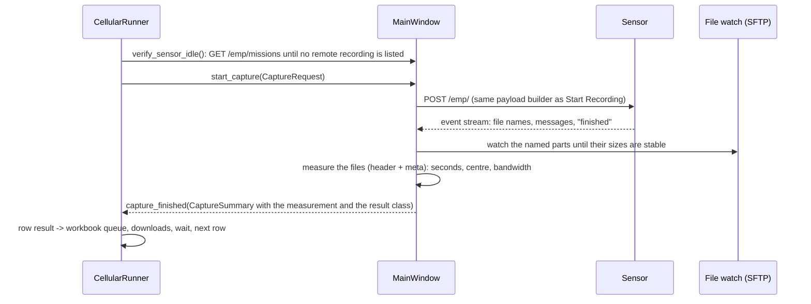

# Excel Collection - how it works (developer report)

**Version:** CRFS IQ Recorder 1.13.0 (November 2026)
**Operator guide:** the "Excel Collection" section of the [Quick Start](confluence/CRFS_IQ_Recorder_Quick_Start.md).
**QA:** `QA_REPORT.md` at the repository root, Parts D to G.

Excel Collection (called Cellular Collection before 1.13.0) records the frequency ranges listed in a protocol workbook, row by row and in worksheet order, waits between recordings, and repeats the whole list (back to back or at scheduled local times) so activity can be compared at different hours. It fills the protocol's own result cells and nothing else. It lives inside the Recorder and reuses its recording path, SFTP download, merge engine and worker-thread registry.

**1.13.0: one request per row.** Each protocol row is sent to CRFS as one recording request using the listed frequency range and the duration selected in the app. The application no longer chooses a capture window from the duration, no longer applies its 625 MB per-capture budget, and never splits, narrows, shifts or rounds a range. The only conversions are the ones the API needs (units to Hz, start/stop to centre/bandwidth); a row whose centre is not a whole number of Hz is reported, not changed. CRFS accepts, rejects or executes the request by its own rules, and what it recorded is read from its files afterwards. Plans saved by 1.10.0-1.12.0 (which could contain automatic sub-band requests) are recognised as *legacy*: their results are kept, they are never continued, and the operator starts a fresh plan or discards them.

Do not put sensor addresses, logins or passwords in this file.

## Modules

| Module | Purpose |
| --- | --- |
| `capture_api.py` | `CaptureRequest` / `CaptureSummary` and the outcome vocabulary shared by the GUI and the runner. |
| `capture_measure.py` | What a recording holds, from the WAVE header (samples, sample rate) and the CRFS `meta` trailer (start time, centre, bandwidth); the result classes and `PARTIAL_TOLERANCE`. Nothing is estimated from sizes or elapsed time. |
| `cellular_protocol.py` | Workbook import by headers (band, direction, duplex, start, stop, sensor, result columns), unit parsing, validation, result-row detection, versioned snapshot. |
| `cellular_capabilities.py` | What the model number says (tuning range, instantaneous bandwidth, sample-rate tiers), for a warning before Start and the size estimate only. It never changes a request. |
| `cellular_plan.py` | Ordered task list (worksheet order): one request per row with the row's own start/stop and the app duration; storage estimate; `legacy` flag for older saved plans. |
| `cellular_scheduler.py` | Run-now with a repeat count (0 = until stopped) or times of day (dates or daily); local time; due / delayed / missed classification. |
| `cellular_runner.py` | The controller (QObject): task state machine, idle check before every request, waits, Pause/Resume/Stop, persistence and recovery, downloads, checksums, quality checks, manifests, the workbook queue, pass counts and **Retry failed rows**. |
| `cellular_workbook.py` | Cell-level writer for the protocol worksheet (block 0 in place, later passes appended), persistent `WorkbookQueue`, backup-before-first-change, openpyxl and Excel-COM back ends. |
| `cellular_panel.py` | The Excel Collection tab: form, plan preview, pass summary, result card and the action bar the main window pins under the tab. |
| `result_view.py`, `result_card.py` | The "Last recording" card shared by both tabs: requested next to received, the tag, and separate recording / transfer / Excel states. |
| `diagnostic_log.py`, `diagnostic_report.py` | The rotating diagnostic log and the text behind **Copy details**. |
| `desktop_open.py`, `waterfall_dialog.py`, `recording_download.py` | **Open folder**, **View waterfall** (same preview code as Sensor Files) and the manual card's **Download**. |
| `cellular_pickers.py`, `theme.py` | Date/time pickers; palettes and the application style sheet. |
| `cellular_manifest.py`, `cellular_quality.py`, `cellular_excel.py`, `cellular_reference.py` | Manifests and handover; WAV validation and sampled previews; row helpers; reference allocations for tests. |

## Capture path

- `MainWindow.start_capture` returns a reason string when it cannot start (manual recording running, series active, invalid plan, storage gate) and otherwise emits exactly one `capture_finished` for the request, including on every failure path.
- The exact payload of every request is in the diagnostic log (`request` lines), with the owner and the row label.
- **Result classes** (`capture_measure.classify`): *completed* - every file read and together at least the requested duration less **2 %** (`PARTIAL_TOLERANCE = 0.02`); *partial* - less than that, a named file missing or cut short, or a sensor error after writing started; *unconfirmed* - files found but their duration unreadable (for example HDF5), or no file confirmed for a request the sensor may have run; *failed* - not sent, or rejected by the sensor. A recording is never marked complete because the requested time elapsed.
- **Recorded range:** taken from the file metadata only, otherwise "unknown". When it differs from the request by more than 1 kHz the card says `Recorded (file metadata): 3500-3600 MHz (100 MHz), not the requested range` and the tag reads **Other range** (amber); the row still counts as completed in the pass counts, because the class is about time and data. The Node 100-18 records a 500 MHz request (3300-3800 MHz) as one 100 MHz recording around the centre; it says so in its reply and its metadata.
- **No automatic re-send**, with one exception: a request that provably never reached the sensor (no connection) is sent once more, unchanged. Anything that may have reached the sensor is never resent automatically; an uncertain row is checked against the mission list and the sensor's files first (**Check with the sensor**).
- The wait between recordings starts only after the capture is confirmed. Downloads start from a fresh listing `FINALIZE_SETTLE_S` after confirmation. When more than `DEFAULT_BACKLOG_LIMIT` (8) downloads are waiting the collection pauses itself ("Downloads: 9 waiting (limit 8). Recording resumes when they catch up.") and continues by itself; this happened on the hardware run over a slow VPN link. When it continues because files were given up rather than downloaded, the line says so (`Not downloaded: 11 files, still on the sensor. The collection continues.`).
- **Persistence:** `cellular/session.json` under the config folder holds the plan, rounds, task states (with every attempt in `history`), file states and settings; it is rewritten atomically after every change.

## Downloads (1.14.0)

Seen on the Node 100-18 over OpenVPN (4 Nov 2026): after about six new SSH connections within ten seconds the sensor accepted no further ones (the TCP connect timed out while HTTP answered) until nothing had been tried for ~15 s. Two download workers that retried at once, plus listings and storage polls that each opened a connection, kept it that way: 11 of 15 files were given up after three "attempts", and the backlog line then said `Downloads caught up`.

- **New SSH connections are paced process-wide** (`sftp_client.ConnectPacer`): at most `SSH_CONNECTS_PER_WINDOW` (3) per `SSH_CONNECT_WINDOW_S` (10 s). After a connect timeout no connection is tried for `SSH_COOLDOWN_S` (20 s, doubling to 60 s), then one at a time until one gets through. Open sessions are not limited; the handshake gate (2 at once) stays.
- **Waiting for a connection is not a download attempt.** `FileDownloadWorker` waits (`waiting`), tries again on its own and gives up after `CONNECT_PATIENCE_S` (10 min, `unreachable`). The Activity panel says it once (`Downloads are waiting: the sensor is not accepting new connections. They try again on their own.`), again when connections are accepted, and once when downloads stop (`Downloads stopped: … use Retry downloads.`); every try is in the diagnostic log.
- **A transfer that fails** (cut short, local check failed) is tried again `DOWNLOAD_RETRY_DELAY_S` (10 s) later, at most three attempts, then marked *Download failed* with one Activity line per file.
- **Downloaded means verified locally:** the copy has the sensor's size at the end of the transfer (re-read after the copy), and a WAVE copy parses and holds the same samples as were read from the file on the sensor (within 1.5 samples). A same-size local copy that does not check out is downloaded again and replaced, never doubled.
- **Retry downloads** in the pass summary (shown with `Not downloaded: N files, still on the sensor.`) queues the given-up files again; nothing is recorded again and the sensor's files are never deleted.
- **Sensor Files:** the history columns are labelled **Req.** (requested); **Recorded (MHz)**, **Recorded (s)** and **Rate (MS/s)** come from `file_measurements` (what the app read from each file's header and metadata at confirmation, from a preview, from a downloaded copy, or from the collection session), keyed by the file's path on the sensor and valid only at the size it was read; otherwise *unknown*. Sizes are decimal (MB = 10^6 bytes) everywhere; tooltips give exact bytes and MiB. A file already saved with the sensor's size is not downloaded again.

## Tabs, states and the pass summary (1.13.0)

- The main window has two tabs, **Manual Recording** and **Excel Collection**, under one shared sensor header. Only one of them controls the sensor at a time: while one runs or is paused, the other's Start is disabled and a reason line says why (`Excel Collection is running.`, `Excel Collection is paused. Stop it first.`, `Manual recording is running.`, `Manual recording is paused. Stop it first.`). Switching tabs never interrupts anything. The last selected tab and the form values are restored at the next start; nothing starts by itself.
- Each tab pins its action bar (status line, Start, Pause/Resume, Stop) under its form, so it stays in view while the form scrolls. A missing workbook disables Start with the tooltip `Load a protocol workbook first.`
- **States are kept apart:** recording (*Recording → Waiting for files → Files ready*, or *Not confirmed* / *Not recorded*), transfer (*On the sensor → Downloading → Saved locally*, or *Download failed*) and Excel (*Excel updated* / *Excel update pending* / *Excel update failed*). A slow download never keeps the recording indicator at *Recording*. While downloads lag, the detail line shows `Downloads: N waiting`.
- **Last recording card:** title (`Row 3 of 15: 703-713 MHz (attempt 2)`), tag (*Complete*, *Partial*, *Uncertain*, *Failed*, *Other range*), `Requested: 100 MHz for 2 s`, `Received (read from the files): 2 files, 1.400 s at 125 MS/s, 700 MB`, `Recorded (file metadata): …`, the three states, **Open folder** (Explorer with the file selected) and **View waterfall**; both are disabled with "Download required." until every file of that recording is in the download folder. The manual card also has **Download**.
- **Pause** stops after the current recording; the countdown of a manual series freezes and the paused time counts toward the wait; Stop while paused ends the series.
- **End of a pass:** `Completed 12 · Partial 0 · Failed 1 · Uncertain 0`, and **Retry failed rows** when there is something to retry. Retry first checks uncertain rows with the sensor (a row whose file turns up is counted and never sent again), then sends only the failed rows again, unchanged, as new attempts (`attempt 2`); completed and partial rows are kept and not retried. A failed attempt writes nothing to the workbook, so the retry fills the same row cells. A row whose result cells were typed by hand is a *conflict*: reported once, never overwritten, never retried. **Retry downloads** appears when files of the pass were not downloaded (1.14.0).

## Activity log and diagnostics (1.13.0)

- The **Activity** panel shows short operator sentences only (`Recording row 2 of 15: 698-748 MHz for 0.5 s.`, `Recording confirmed: 1 file, 0.50 s.`, `Partial recording: requested 2 s, received 1.4 s.`, `The sensor request failed. See details.`); no tracebacks, no identifiers, no paths of temporary files. A repeated sensor warning (`Using internal clock because of ncpd.conf settings`, 5-30 per second on the Node 100-18) gives one line per session (`CRFS warning: the sensor uses its internal clock, not GPS. Shown once.`), the count goes to the diagnostic log.
- The **diagnostic log** (`logs/diagnostic.log` under the settings folder, 2 MB × 5 rotating files) has the full detail: payloads, replies, sensor messages with counts, SFTP problems, stack traces. **See details** opens it. Every line passes the sanitizer; every stored secret of three characters or more is masked wherever it appears as a whole word. The sensor's position in a reply (`latitude`, `longitude`, `altitude`, sent by the Node 100-18 in every RemoteTimeData reply) is written as `<location>`.
- **Copy details** puts a report on the clipboard: application version, sensor model and serial, the last request exactly as sent (local and UTC time), what came back, and the latest diagnostic lines. The sensor's address is replaced with `<sensor-address>`, any other IPv4 address with `<address>`, the home folder with `%USERPROFILE%`, the position with `<location>`, and secrets are masked.

## Sensor messages and the idle check (1.10.0)

1. **Repeated WARNING hid the real error.** `EmpClient.start_recording` keeps distinct messages with a repeat count; a WARNING is never fatal; only an ERROR/FATAL/CRITICAL level ends a recording.
2. **A late ERROR after "finished".** "Finished wins": the outcome stays *accepted*, the late error is logged and the files decide. The GUI releases the stream as soon as the files are confirmed.
3. **A dead SFTP watch session looked like an empty folder.** `list_watch_entries` raises when the session is closed or every folder fails to list, and the watch reconnects and says so once.
4. **The next POST was refused.** The Node keeps the remote-recording mission open until the client disconnects. Before every request the runner reads `GET /emp/missions` (read-only) through `MainWindow.verify_sensor_idle` and waits until no remote recording is listed (bounded, then pause with the reason). The Node 100-18 also lists a standing `EMP Sweep` mission; it is not a remote recording and does not block.

## Sensor identity

The panel reads the sensor's identity right before Start (`MainWindow.fetch_sensor_identity`, worker) and the runner refuses to start or resume when the connected model/serial differs from the one the plan was made for (`CellularRunner.identity_mismatch`). Two addresses can lead to the same unit (a local cable and a VPN route); only a matching serial makes them the same sensor.

## Workbook (cell-level, `cellular_workbook.py`)

- The imported worksheet is the plan: its valid rows, in worksheet order, are stored in the session as `plan_rows`. Appended result blocks are recognised by key and never become instructions; the workbook's duration column is a result, never an instruction.
- **Block 0** is the plan rows themselves, used by the first pass while their result cells are empty. Every further pass gets a **new block** of the same rows appended below the last used row (key cells copied with their styles, result cells empty except Sensor). Blocks are re-located by key before every write.
- Values: **Sensor** = readable name from the verified identity (`CRFS 100-18`); **IQ Recording** = the recording's files one per line (size-split parts grouped); **IQ Duration (s)** = measured seconds, three decimals, or empty when unknown (never the requested value); **Recording Date & Time** = capture start in local time as a real datetime. Only these cells of the app's own rows are written.
- **Queue:** results go to `cellular/workbook_queue.json` and are flushed on a worker; the queue survives restarts. **Backup first:** one `.crfs-backup-<stamp>` copy before the first change of every session. **Excel open:** cells are written through COM into the open workbook and saved; a locked file without COM access is *busy* and retried.

## Schedule, passes, sleep

- `Schedule(mode, times, dates, daily, tz, repeat)`: run-now with `repeat` passes (0 = until stopped) spaced by the wait, or times of day on dates / daily, always the computer's local time zone.
- Passes never overlap. A pass that becomes due while the sensor is busy is *delayed*; one missed while the app was closed or the computer asleep is listed (**Run the missed pass now** / **Skip it**) and never starts on its own at another hour.

## Background work

All waiting, listing, downloading, hashing, checking, workbook writing and identity/idle checks run off the UI thread (`QThread` workers tracked by `worker_threads`, queued signals, `MAX_DOWNLOADS` parallel downloads, backlog and local-disk gates). The Excel Collection form is built the first time its tab opens, or at start-up when a saved session must be shown.

Downloads, checksums and quality checks belong to the session that recorded the files. A new collection therefore waits until the last one has finished them (Start disabled, `The last collection is still downloading (N waiting). Start the next one when the downloads finish.`), and Dismiss waits too. If the application closes before a finished collection's downloads complete, the next start shows `The application was closed before N downloads finished. The files are on the sensor; Continue downloads them.` Continue checks the sensor's identity and only downloads: nothing is sent and the sensor is not held. (Seen on hardware, 3 Nov: a collection started while the previous one was still downloading took those downloads over in memory only; the ones that finished were never recorded and the rest were forgotten at the next start.)

## Tests

`tests/test_cellular_*.py`, `tests/test_capture_measure.py`, `tests/test_result_view.py`, `tests/test_workflow_tabs.py`, `tests/test_operator_messages.py`, `tests/test_emp_stream.py`: one request per row with unchanged parameters at every duration, legacy plans refused, the measured duration and range from WAVE headers and meta (2 % tolerance, unknown stays unknown, *Other range*), no re-send except provably unsent, Retry failed rows (reconcile first, attempt 2, partial kept), failed attempts write nothing, hand-typed conflicts reported once, tabs with one controller and the reason lines (running and paused), restore without auto-start, manual pause/resume/stop, the result card's Download / Open folder / View waterfall, a download backlog said once, a new collection waiting for the last one's downloads and a restart offering them again, the sensor's position never written out, every operator message scanned for length, identifiers, tracebacks and secrets, plus the earlier workbook, queue, schedule and stream tests. Hardware results are in the QA report (Part G).
